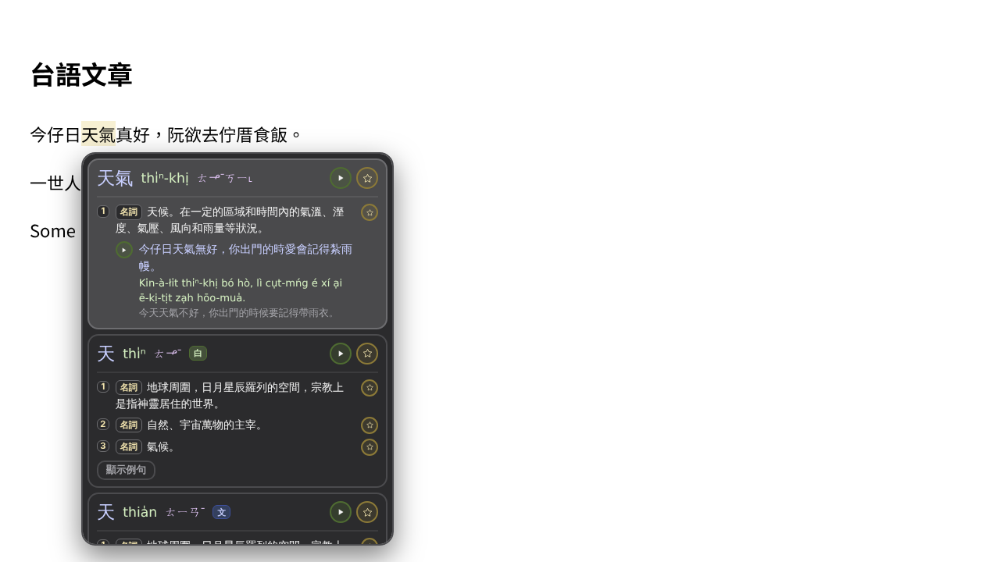
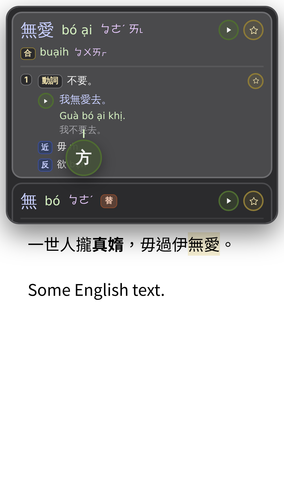

# 方方 Safari 台語查詞

Safari 的台語查詞擴充功能，適用 Mac、iPhone、iPad。外觀和 [方方轉換器](https://unoki99.github.io/fangfang/) 一樣，顯示漢字、皓羅（台羅／白話字可切換）、方音、釋義、例句和音檔，也可以收藏詞。

*A Safari extension (Mac, iPhone, iPad) that pops up a Taiwanese (台語) dictionary over Chinese characters on any web page — with 皓羅 / 台羅 / POJ, 方音, Mandarin definitions, examples, audio and saved words. Instructions below are in Mandarin; the commands work as-is.*

| Mac：滑鼠移到漢字上 | iPhone：拖動「方」到文字下面 |
|---|---|
|  |  |

## 功能

- **Mac**：把滑鼠移到漢字上，找到詞就自動跳出視窗。按 Esc 或移開滑鼠就關閉。
- **iPhone／iPad**：拖動畫面上的「方」圓圈，讓上方的小線指著文字。點一下「方」可以開關查詞。
- **iPad 接觸控板或滑鼠**：跟 Mac 一樣，滑鼠移到漢字上就查詞。
- **收藏**：☆ 收藏整個詞，釋義旁邊的 ☆ 只收藏那一個意思。
- **工具列選單**：開關查詞、切換羅馬字（皓羅／台羅／白話字）、腔口（通行或 10 個地方）、音量、打開收藏頁。
- **腔口**：選一個地方（例如高雄混合腔），有資料的詞會顯示那裡的讀音，方音的 ㄛ／ㄜ 也跟著調整。
- **其他讀音、近反義詞、異用字**：查詞視窗會顯示又／俗／合讀音、近義詞和反義詞；異用字（例如「蜀」）也查得到。
- **收藏頁**：下載 CSV（分號分隔，九欄）、備份匯出／匯入（跟網站同一個格式）。
- 字典全部在擴充功能裡面，不用網路也能查。音檔從 `unoki99.github.io/fangfang` 播放。

## 需要的東西

- 一台 Mac，安裝 **Xcode**（App Store 免費下載）
- 一個 Apple ID（免費的就可以）
- iPhone／iPad 要用傳輸線接到 Mac（第一次安裝時）

> 用免費 Apple ID 安裝在 iPhone／iPad 上的 App **7 天後會失效**，要重新安裝一次（Mac 版不會）。可以用下面的「自動重新安裝」讓 Mac 自己處理。

## 安裝

### 1. 下載

在 GitHub 這頁按 **Code → Download ZIP**，解壓縮到「下載項目」。或用 Terminal：

```
cd ~/Downloads && git clone https://github.com/你的帳號/fangfang-safari.git
```

### 2. 建立 Xcode 專案

打開 Terminal，執行（路徑換成你解壓縮的位置）：

```
xcrun safari-web-extension-converter ~/Downloads/fangfang-safari/fangfang-ext --app-name Fangfang --bundle-identifier com.你的名字.fangfang --project-location ~/Fangfang-Xcode --copy-resources --force
```

- `--app-name` 請用英文（`Fangfang`）。用中文名字的話，Mac 的 Safari 可能載入不了擴充功能。Safari 裡看到的名字還是「方方」。
- `--bundle-identifier` 換成你自己的，例如 `com.yourname.fangfang`。
- 專案會建在家目錄的 **Fangfang-Xcode** 資料夾，之後請不要移動或刪除它。

Xcode 會自動打開專案。

### 3. 設定簽署

1. 左邊欄最上面點藍色的 **Fangfang** 圖示。
2. 中間的 **TARGETS** 有四個項目（iOS、macOS、Extension (iOS)、Extension (macOS)）。每一個都：
   - 打開 **Signing & Capabilities**
   - 勾 **Automatically manage signing**
   - **Team** 選 **你的名字 (Personal Team)**

   如果沒有 Personal Team：Xcode → Settings → Accounts → **+** → 用 Apple ID 登入。

### 4. 安裝到 Mac

1. 視窗上方中間的列，點左邊的 scheme 名稱，選 **Fangfang (macOS)**；右邊選 **My Mac**。
2. 按 **▶**（⌘R）。會跳出一個小小的方方視窗，可以關掉。
3. Safari → 設定 → **進階** → 勾「顯示網頁開發者功能」。
4. Safari → 設定 → **開發者** → 勾 **允許未簽署的延伸功能**。
   *（Safari 每次結束後這個選項會自己關掉，查詞沒反應的時候先檢查這裡。）*
5. Safari → 設定 → **延伸功能** → 勾 **方方**。
6. Safari → 設定 → **網站** → 方方 → 其他網站選 **允許**。
7. 重新載入網頁，把滑鼠移到漢字上。

### 5. 安裝到 iPhone／iPad

1. 用傳輸線接上 iPhone，解鎖。手機問「要信任這部電腦嗎？」→ **信任**。
2. iPhone：設定 → 隱私權與安全性 → **開發者模式** → 打開，重新開機後確認。
3. Xcode 上方選 **Fangfang (iOS)**，右邊選 **你的 iPhone**（不是 Any iOS Device）。
4. 按 **▶**。
5. 第一次要在 iPhone：設定 → 一般 → **VPN 與裝置管理** → 信任你的 Apple ID。
6. iPhone：設定 → App → Safari → **延伸功能** → 方方 → 打開，**所有網站** 選 **允許**。
7. 用 Safari 打開有漢字的網頁，畫面右下角會出現「方」。

iPad 一樣的步驟，第 3 步選你的 iPad。

## 自動重新安裝（每 7 天）

接過一次傳輸線之後，Xcode 可以透過 Wi-Fi 安裝。`tools/fangfang-refresh-setup.sh` 會在 Mac 上設定一個排程：

- 每天 12:00 檢查（Mac 睡眠的話就在醒來時檢查），距離上次安裝 5 天以上就重新建置，透過 Wi-Fi 安裝到所有找得到的 iPhone／iPad。
- 完成後 Mac 會跳出通知。紀錄在 `~/Library/Logs/fangfang-refresh.log`。

設定（一次）：

```
bash ~/Downloads/fangfang-safari/tools/fangfang-refresh-setup.sh
```

馬上測試（手機要解鎖、跟 Mac 在同一個 Wi-Fi）：

```
~/bin/fangfang-refresh.sh --remote
```

### 從 iPhone 用捷徑啟動

1. Mac：系統設定 → 一般 → 共享 → 打開 **遠端登入**。
2. iPhone 捷徑 App → 新增捷徑 → 動作 **透過 SSH 執行工序指令**：
   - 主機：`你的Mac名稱.local`（遠端登入設定頁面上有寫）
   - 使用者：你的 Mac 帳號名稱，密碼：Mac 的密碼
   - 工序指令：`~/bin/fangfang-refresh.sh --remote`
3. 後面加一個 **顯示結果**。

## 更新擴充功能

下載新版之後，把檔案複製到 Xcode 專案裡，再重新建置：

```
NEW=~/Downloads/fangfang-safari/fangfang-ext
find ~/Fangfang-Xcode -name manifest.json -not -path "*/build/*" | while read m; do grep -q haolo.woff "$m" && rsync -a "$NEW/" "$(dirname "$m")/" && echo "updated: $(dirname "$m")"; done
```

然後在 Xcode 按 **⇧⌘K**，再分別選 Mac／iPhone／iPad 按 **▶**（或執行 `~/bin/fangfang-refresh.sh --remote`）。

## 常見問題

| 狀況 | 解決 |
|---|---|
| Mac 上滑鼠移過去沒反應 | 先檢查 **允許未簽署的延伸功能** 有沒有勾（Safari 重開後會被關掉）。再重新載入網頁。 |
| 延伸功能列表有方方，但工具列沒有、也不會查詞 | 確認建立專案時 `--app-name` 用的是英文。Safari → 開發 → Web Extension Background Content 裡要看得到方方。 |
| Xcode：A build only device cannot be used to run this target | 上方選的是「Any iOS Device」或「Any Mac」。改選 **My Mac** 或你的 iPhone。 |
| Xcode：Your team has no devices… | iPhone 還沒接上 Mac。接傳輸線、信任、開開發者模式，再按 ▶。 |
| Xcode：Failed to register bundle identifier | bundle identifier 被別人用過了，換一個（四個 target 都要改，Extension 的要以 App 的開頭）。 |
| iPhone 上「方」變淡了 | 點一下「方」就會重新打開查詞。 |
| ▶ 變紅色 | 找不到音檔。可以在工具列選單的「音檔來源」換網址。 |
| 跳出「查詞出錯：…」 | 把那一行文字回報，通常是字典載入失敗。 |
| iPhone 上的 App 打不開了 | 7 天到期了，重新按 ▶ 或執行自動重新安裝。 |

## 檔案

```
fangfang-ext/            擴充功能本體
  manifest.json          設定
  background.js          字典查詢、收藏、設定、下載音檔
  content.js             網頁上的查詞視窗、Mac 滑鼠查詞、iPhone「方」圓圈
  popup.html / popup.js  工具列選單
  saved.html / saved.js  收藏頁（CSV、備份）
  common.css             共用樣式
  data.json              字典資料
  haolo.woff             皓羅字型（DejaVu Sans 子集）
  images/                圖示
  _locales/              名稱（中文／英文）
tools/
  fangfang-refresh-setup.sh   iPhone／iPad 自動重新安裝
```

## 資料來源與授權

本擴充功能與教育部無關，不是官方產品。

- **詞條、讀音、釋義、詞性、文白讀、例句、近反義詞、異用字、腔口差異、各地講法、人名姓氏讀音、華語對照詞**：教育部《臺灣台語常用詞辭典》 — [sutian.moe.edu.tw](https://sutian.moe.edu.tw/)
  授權：[創用CC 姓名標示-禁止改作 3.0 臺灣](https://creativecommons.org/licenses/by-nd/3.0/tw/)。釋義、例句原文照錄，僅擷取部分欄位顯示。讀音依規則由台羅轉成皓羅、方音、白話字顯示（`data.json` 裡存成音節編碼）。華語對照詞擷取自辭典的釋義與例句華語翻譯。
- **推算的讀音**：辭典沒有直接寫出的部分腔口讀音，是依「/」並列讀音與加 r 的規則推算的，不是教育部的資料。
- **讀音音檔**：教育部《臺灣台語常用詞辭典》詞條與例句音檔，授權同上，原始音檔未經修改，從方方網站讀取。
- **音節編碼**：YuRen-tw（Yu-Ren Pan）《rime-taigi-tps》的拼音系統，經作者同意使用 — [github.com/YuRen-tw/rime-taigi-tps](https://github.com/YuRen-tw/rime-taigi-tps)
- **單字常用度參考**：Rime《八股文》（LGPL-3.0） — [github.com/rime/rime-essay](https://github.com/rime/rime-essay)
- **皓羅拼寫系統**：Unoki99
- **自補詞條**：標示「自補」的詞條及讀音為 Unoki99 自行補充，非教育部辭典內容。
- **皓羅字型**（`haolo.woff`）：DejaVu Sans 的子集 — [dejavu-fonts.github.io](https://dejavu-fonts.github.io/)，授權見 [`licenses/DejaVu-LICENSE.txt`](licenses/DejaVu-LICENSE.txt)
- **方音**：臺灣方音符號（朱兆祥 1946 年設計，教育部推行的注音系統） — [zh.wikipedia.org/zh-tw/臺灣方音符號](https://zh.wikipedia.org/zh-tw/臺灣方音符號)

**程式碼**：MIT 授權，見 [`LICENSE`](LICENSE)。`data.json`、音檔和字型不在 MIT 授權範圍內，各自依照上面的授權。
